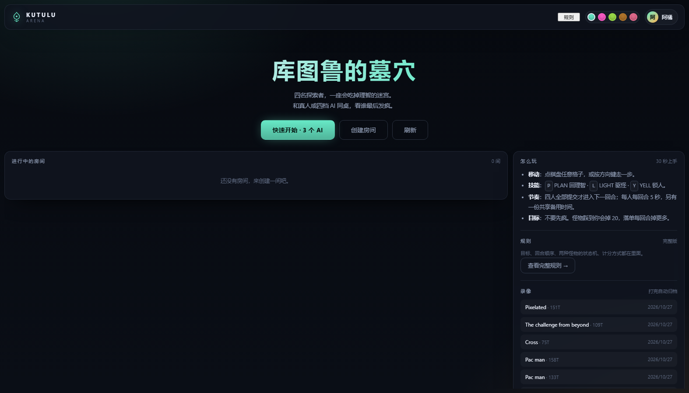
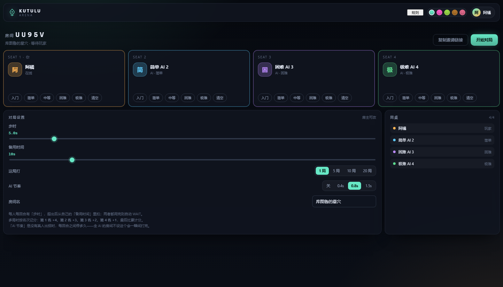
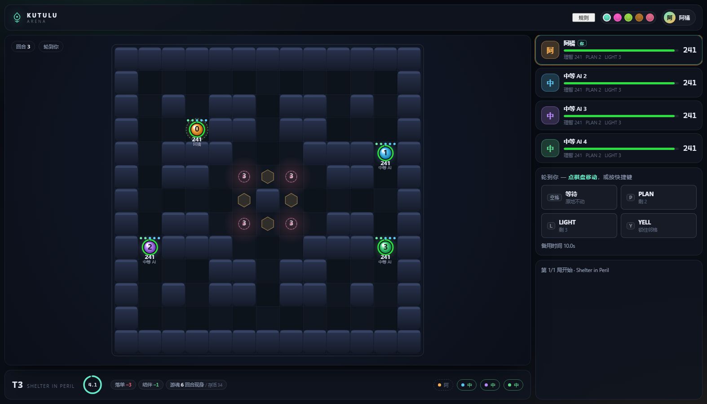
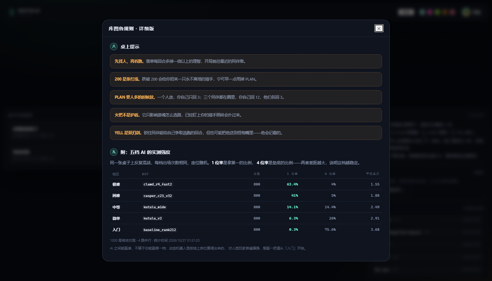
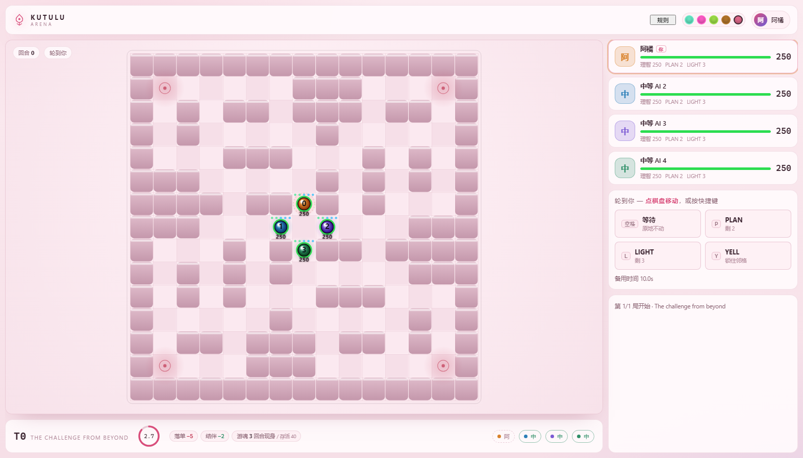

# Kutulu Arena · 库图鲁竞技场

> 把 CodinGame 的 *Code of Kutulu* 做成可以开房对战的网页游戏：四个人，或者你和 AI。
> 每回合同时出招，谁先疯谁出局。



一个**零依赖**的 Node 服务 + 原生前端：没有 npm install，没有构建步骤，`node server/index.js` 就能跑。

- **规则内核**：从原作者的 Java 裁判逐条移植（含 `java.util.Random` 的位级复现、A* 的平局朝向、
  砍杀者的「最后目击点」）。用 38 场平台排位录像做逐回合回归，**4404 个回合实体级全等**。
- **房间与系列赛**：开房、选座、设 AI 难度，1/5/10/20 局积分制，局间自动结算。
- **观战与回放**：全 AI 房间可放慢节奏看；每局自动归档，随时回放。
- **五套配色**：黑曜 / 霓虹 / 苔原 / 羊皮纸 / 樱。

---

## 快速开始

需要 **Node ≥ 18**，不需要编译器，也不需要 npm install。

```bash
git clone git@github.com:huixiong806/code-of-kutulu-arena.git
cd code-of-kutulu-arena
node server/index.js           # → http://localhost:8787
```

Windows 也可以双击 `start.ps1`。换端口：

```powershell
$env:PORT=8788; ./start.ps1
```

```bash
PORT=8788 ./start.sh
```

打开首页 → 开房 → 三个空位会自动填成 AI → 开始对局。

---

## 界面

**房间**：四个座位，房主逐个设 AI 难度，或者留着等朋友（把邀请链接发过去）；步时、备用时间、
局数、AI 节奏都能调。座位上的难度按钮是**按磁盘上真实存在的 bot 生成的**——只有入门一只时
就只显示「入门」，不会出现点了没反应的档位。



**对局**：点棋盘走一步（带寻路预览），方向键走一格，`P/L/Y` 放技能，空格等待。
底部常驻本局随机参数（落单/结伴失血、游魂召唤与存活回合），右侧是本回合日志。



**规则**：顶栏「规则」随时打开完整规则书——回合六阶段、五种动作、两种怪物的行为、
计分方式，以及（装了完整五档时）各档 AI 的实测强度。



配色可以随时换，选择记在本地：



---

## 玩法速览

- 每人 250 理智，**最后一个还活着的人赢**；理智归零出局。
- 四人**同时**出招，全部提交后结算，顺序固定：喊话 → 刷怪 → 移动 → 效果 → 怪物行动 → 被动掉理智。
- 落单每回合掉 3–6，两格内有同伴只掉 1–3（穿墙也算）。
- 怪物踩到你 **-20**；理智掉到 200 以下会招来一只**永不消失**的砍杀者。
- 技能：`PLAN`（回理智，整局 2 次）、`LIGHT`（把游魂推远，3 次）、`YELL`（锁住相邻玩家 2 回合）。
- 时间：步时 5s + 自己的备用池 10s，用完自动 WAIT（**超时不判负**）。

完整规则在游戏里（顶栏「规则」），文本在 `public/js/rules.js`。

---

## 系列赛计分

单局按名次给分，四人合计恒为 10：

| 名次 | 1st | 2nd | 3rd | 4th |
| --- | --- | --- | --- | --- |
| 得分 | +4 | +3 | +2 | +1 |

完全并列（同回合出局且理智相同）平分名次分。可选 **1 / 5 / 10 / 20 局**，累计总分决胜，
同分比单局第一次数。每局结束弹结算面板，默认 30 秒后自动开下一局（房里没真人时 4 秒），
房主可提前开始或结束系列赛。

---

## 五档 AI（参考数据）

正式部署里五档接的是五份真实历史提交。用 **1000 局混战**量过强度
（每档出场 800 次、轮换掉一档、座位随机）：

| 难度 | 1 位率 | 4 位率 | 平均名次 | 来头 |
| --- | --- | --- | --- | --- |
| 极难 | 63.4% | 4.0% | 1.55 | PUCT + 9k 参数网络，22ms 硬截断 |
| 困难 | 41.0% | 5.0% | 1.88 | PUCT + 神经网络 |
| 中等 | 14.1% | 14.4% | 2.49 | 加宽 beam 的搜索版 |
| 简单 | 6.3% | 26.0% | 2.91 | 第一代搜索版（3 层 beam） |
| 入门 | 0.3% | 75.6% | 3.68 | 手写启发式，纯规则无搜索 |

五档的编译产物都在 `bots/`（Windows x64），源码暂不公开。

换成自己的 AI：把可执行文件放进 `bots/`，改 `server/game/bots.js` 里的文件名映射即可。
Linux / macOS 需要编译对应平台的可执行文件，难度表只认文件名。

---

## 目录

```
server/
  index.js          HTTP + SSE + 静态文件 + 录像读写
  rooms.js          房间、座位、回合时钟、系列赛、AI 子进程
  game/referee.js   规则内核（Java 裁判的移植 + java.util.Random）
  game/maps.js      16 张地图（与平台 Legend 池一致）
  game/bots.js      AI 子进程管理 + 难度表
public/
  index.html        单页应用
  css/app.css       五套配色
  js/board.js       棋盘渲染器（对局与回放共用）
  js/app.js         路由、房间、对战、回放
  js/rules.js       规则书内容
tools/
  verify_replays.mjs  38 场录像的逐回合回归
  ladderstats.mjs     大规模混战统计，写 data/ladder.json
  tournament.mjs / roundrobin.mjs / pairmatrix.mjs   调档
  soak.mjs            四个 bot 连打的压测
  e2e*.mjs            房间 / 系列赛 / 双人翻页的端到端测试
  shot.mjs            无头 Chrome 截图与点按（CDP，无依赖）
bots/                 放 AI 可执行文件（只附带入门一只）
data/ladder.json      五档强度统计（规则页读取）
data/replays/         对局归档（git 忽略）
```

---

## 规则内核的可信度

平台的 API 只给 stdout 文本，没有地图和单位状态。所以这里的做法是：
把线上真实对局的原始指令（种子 + 四人每回合的 stdout）喂给运行真实规则的裁判，
重建每回合完整棋盘；再把同一批动作在**这个 JS 内核**里重放，逐字段比对。

```bash
CK_GAMES=<录像目录> node tools/verify_replays.mjs
# 38/38 games match, 4404 turns compared
```

比对的不只是终局分数，而是每回合的四名玩家 + 怪物 + 效果（位置、理智、剩余技能、
怪物状态与目标、庇护所能量……），包括 A* 的平局朝向和 RNG 抽样顺序。
改任何规则相关代码都应该重跑它。样本不在仓库里（体积 + 版权），用 `CK_GAMES` 指过去。

---

## 部署成常驻服务

```ini
# /etc/systemd/system/kutulu-arena.service
[Unit]
Description=Kutulu Arena
After=network.target

[Service]
WorkingDirectory=/srv/kutulu/code-of-kutulu-arena
ExecStart=/usr/bin/node server/index.js
Environment=PORT=8787 HOST=127.0.0.1
Restart=always

[Install]
WantedBy=multi-user.target
```

```nginx
location / {
    proxy_pass http://127.0.0.1:8787;
    proxy_http_version 1.1;
    proxy_set_header Connection "";
    proxy_buffering off;          # 关键：不然 SSE 会被憋住
    proxy_read_timeout 3600s;
}
```

配置：`config.json`（`{"port": 8787, "host": "0.0.0.0"}`）或环境变量 `PORT` / `HOST`。

对局结束会自动归档到 `data/replays/`（每局一个 JSON + `index.json`），录像页直接读它。
房间只存在内存里，进程重启即清空。

---

## 已知取舍

- **单进程、内存房间**：要横向扩展得换成共享存储。
- **AI 是可执行文件**：每个 AI 座位一个常驻子进程，一局结束回收；异常退出会退化成
  一直 WAIT，不会卡住整桌。
- **没有账号系统**：靠房间码 + 本地 token 认座，适合个人站。
- **观战**：对局开始后加入的人自动进入观战模式，可以看到全部状态。

---

## 致谢

- **规则、地图、判负细节**：CodinGame 官方 *Code of Kutulu* 及其开源裁判，作者 **JohnnyGuye**。
- **困难 / 极难两档 AI**：来自群友 **mbfCasper** 和 **clawd-kaozi** 的分享。
